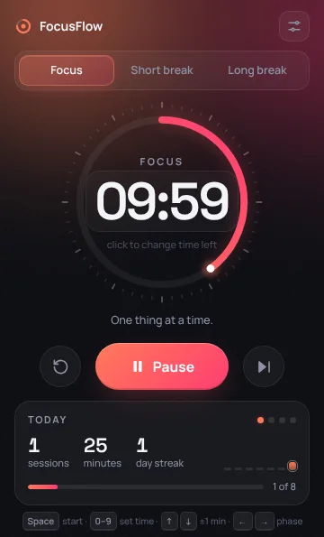

# FocusFlow 🍅

A calm **Pomodoro timer** Chrome extension (Manifest V3). Focus for 25 minutes, take a 5 minute break, and after 4 rounds take a long break. You get a notification and a soft chime every time a phase ends.

**Live page:** https://focusflow-ext.vercel.app



## Features

- Focus, short break and long break phases with an animated progress ring
- Runs in the background with `chrome.alarms`, so it keeps going when the popup is closed
- Desktop notifications with a "Start break / Start focus" button, plus a synthesized chime (offscreen document)
- Toolbar badge showing minutes left, colored by phase
- Daily stats: sessions, focus minutes, day streak and a daily goal
- Settings for every duration, long-break interval, auto-start and sound
- Shortcuts: `Alt+Shift+P` anywhere, `Space` inside the popup
- Zero dependencies, no build step, no tracking

## Install (unpacked)

1. Download `focusflow-extension.zip` from the live page (or clone this repo).
2. Unzip it, open `chrome://extensions` and switch on **Developer mode**.
3. Click **Load unpacked** and pick the `focusflow-extension` folder (or the `extension/` folder of this repo).
4. Pin FocusFlow from the puzzle-piece menu.

## Project layout

```
extension/   the Chrome extension (manifest, service worker, popup, offscreen audio)
site/        static landing page deployed to Vercel, includes the packaged zip
```

`npm run build` re-packages `extension/` into `site/focusflow-extension.zip`.

## License

MIT
